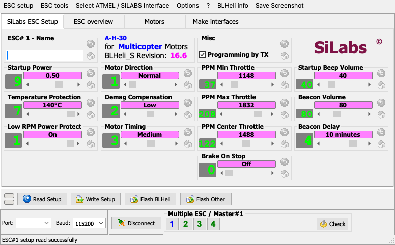
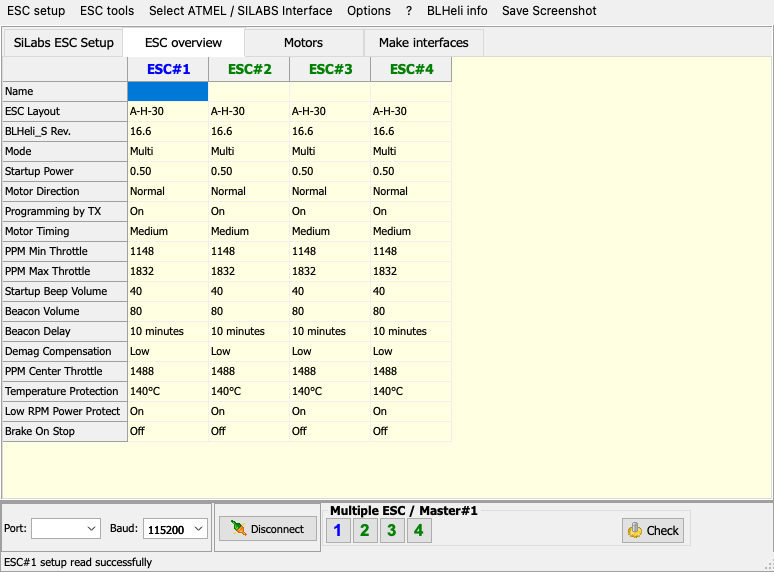
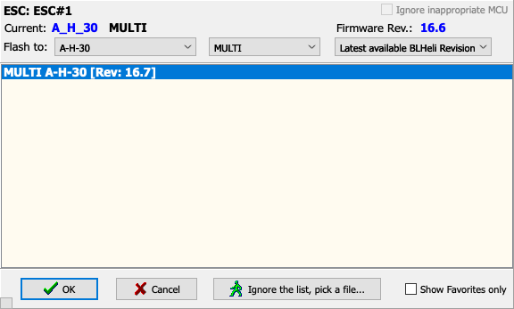

# BLHeliSuite for macOS

An unofficial, native macOS port of **BLHeliSuite 16.7.14.9.0.2** – the classic Windows tool for configuring
and flashing brushless ESCs that run **BLHeli_S**, **BLHeli (SiLabs)** or **BLHeli (Atmel)** firmware.

BLHeliSuite only exists for Windows. This project recreates it on the Mac one-to-one: the same windows, the
same menus and dialogs, the same messages and the same programming procedures, rebuilt from the original
program by reverse engineering. It runs natively on Apple Silicon and Intel Macs (macOS 13 or newer) and talks
to the ESCs directly over USB – no Windows, no virtual machine, no Wine.



| ESC overview | Flash Assistant |
|---|---|
|  |  |

## What is BLHeliSuite?

[BLHeli](https://github.com/bitdump/BLHeli) is an open-source firmware for the brushless speed controllers
(ESCs) used in multicopters, helicopters and planes. BLHeliSuite, written by *4712*, is the PC program that
reads and changes the ESC settings (motor direction, timing, startup power, beacon, throttle range …) and
flashes new firmware revisions. It can reach the ESCs through a flight controller (passthrough), through an
Arduino based programming interface, through a USB-UART adapter, through a SiLabs ToolStick or through an AVR
ISP programmer.

## Features

Everything in the Windows program is ported:

* **ESC setup** – all BLHeli parameters with the original ranges, value texts, defaults, hints and colours;
  Undo / Default buttons, ESC name, governor settings with the motor/gear calculator, LED control.
* **Multiple ESC mode** – ESC buttons 1–8 with master/slave handling, *Check*, *Copy* / *Paste*, synchronised
  motor direction and throttle range (Options menu), status markers (`u`, `f`, `b`, `m`, `x`, …).
* **ESC overview** – all connected ESCs side by side; values differing from the master are highlighted,
  non-default values are bold.
* **Flash BLHeli / Flash Other** – Flash Assistant with the complete built-in firmware library of BLHeliSuite
  (8881 hex files for 774 ESC layouts, extracted from the original DLLs), favourites, revision/MCU/layout
  checks, the "Just one last question …" confirmation, settings carried over to the new revision, recovery
  of interrupted flashes (`**FLASH*FAILED**`).
* **Motors** – motor test through the flight controller (MSP), ESC calibration, enhanced tests.
* **Make interfaces** – flashes the 4-way-if, 1-wire, USBLinker and ArduinoISP firmware to Arduino boards and
  updates the bootloader of programming boxes (ATmega8, RBBX, TDLX, TAQX).
* **Expert tools** – read / write / erase memory, erase pages, flash any file, show hex and binary files,
  identify and verify flash memory, AVR fuses.
* Setup files (`.ini`, single and multiple ESC), reading setups from hex / eep files, log window,
  screenshots, the original PDF manuals.

### Interfaces

Selected in **Select ATMEL / SILABS Interface**, exactly as in the Windows version:

| | Interface | Connection |
|---|---|---|
| A | SILABS C2 (Toolstick) | SiLabs ToolStick / USB Debug Adapter (USB HID) |
| B | SILABS C2 (4way-if) | Arduino 4-way interface in C2 mode |
| C | SILABS BLHeli Bootloader (USB/Com) | USB-UART adapter, 1-wire |
| D | SILABS BLHeli Bootloader (4way-if) | Arduino 4-way interface |
| E | SILABS BLHeli Bootloader (Cleanflight) | flight controller passthrough (Betaflight, Cleanflight, INAV …) |
| 1 | ATMEL BLHeli Bootloader (USB/Com) | USB-UART adapter, 1-wire |
| 2 | ATMEL BLHeli Bootloader (4way-if) | Arduino 4-way interface |
| 3 | ATMEL SK Bootloader (4way-if) | Arduino 4-way interface, SimonK bootloader |
| 4 | ATMEL SK Bootloader (ArduinoUSBLinker) | Arduino with ArduinoUSBLinker |
| 5 | ATMEL SK Bootloader (Afro/Turnigy USB Linker) | Afro / Turnigy USB linker |
| 6 | ATMEL BLHeli/SK Bootloader (Cleanflight) | flight controller passthrough |
| X | ATMEL ISP Interface (AVRDude) | USBasp, ArduinoISP … (needs `avrdude`) |

BLHeli_32 and AM32 (ARM) ESCs are not supported – the original BLHeliSuite 16.7 does not support them either.

## Installation

### Build from source

Only Apple's Command Line Tools are needed (`xcode-select --install`); Xcode is not required.

```sh
git clone https://github.com/KarolSieradzki/BLHeliSuiteMac.git
cd BLHeliSuiteMac
./build_app.sh --install
```

`build_app.sh` compiles a release build, runs the self-test suite, assembles and ad-hoc signs
`build/BLHeliSuite.app` and – with `--install` – copies it to `/Applications`. The previous build is kept in
`build/.previous` (`./build_app.sh --rollback` switches back). In Finder, double-clicking
`Aktualizuj BLHeliSuite.command` does the same.

The interface firmware files, manuals and example hex files are taken from the original Windows distribution
of BLHeliSuite 16.7.14.9.0.2, expected next to the project in `../BLHeliSuite` (or set
`BLHELISUITE_WINDOWS=/path/to/BLHeliSuite`).

Because the app is only ad-hoc signed, macOS blocks it on other Macs the first time it is opened; allow it in
*System Settings → Privacy & Security → Open Anyway*.

### Optional

* `brew install avrdude` – required for the ISP interface (X) and for Arduino boards that are not flashed
  through the built-in STK500 loader (Mega 2560 / wiring, Leonardo / avr109).
* USB serial drivers – current macOS versions include drivers for the usual adapters (FTDI, CP210x, CH34x).

## Quick start

1. Remove the propellers.
2. Select the interface, e.g. **E – SILABS BLHeli Bootloader (Cleanflight)** for BLHeli_S ESCs on a Betaflight
   flight controller.
3. Choose the serial port (`/dev/cu.usbmodem…`) and press **Connect**; power the ESCs from the battery.
4. **Read Setup**, change the settings, **Write Setup** – or **Flash BLHeli** to update the firmware.

Settings are stored in `~/Library/Application Support/BLHeliSuite/BLHeliSuite.ini` (same sections and keys as
the Windows `BLHeliSuite.ini`); screenshots and saved setups go to `~/Documents/BLHeliSuite`.

## How the port works

The port is a reconstruction of the original program, not a look-alike:

* **Forms.** The Delphi form resources (`TPF0` DFM streams), bitmaps, string tables and RCDATA resources are
  extracted from `BLHeliSuite.exe` by `Tools/extract_vcl_resources.py` into `Resources/VCL`. At run time a
  small VCL compatibility layer (`Sources/VCL`, AppKit based) loads the unchanged DFM files and creates the
  same component tree – `TForm`, `TFrame`, `TPageControl`, `TJvGroupBox`, `TScrollBar`, `TStringGrid`,
  `TActionList`, `TMainMenu` … – with Delphi semantics (alignment, anchors, actions, hints, modal dialogs,
  owner drawing, event binding by handler name).
* **Program logic.** `Sources/BLHeliSuiteApp` follows the Delphi units of the original
  (`TfrmBLHeliSuiteMain`, `TfraESCCombos`, `TfraESCTable`, `TfrmFlashAssistant`, `TfrmConfirmFlash`,
  `TfraMakeInterfaces`, `TfraCFMotorTest`, …). The event handlers were decompiled with Ghidra and ported
  function by function; comments name the original addresses (`FUN_00677AA4`, `0x64D2E0`, …).
* **Protocols.** `Sources/BLHeliCore` implements MSP passthrough, the 4-way interface protocol, the BLHeli
  1-wire bootloader, SimonK / STK500v2, ArduinoUSBLinker, STK500v1 (Arduino), the ToolStick C2 commands
  (IOKit HID) and avrdude for ISP, plus the BLHeli settings model, the settings translator between EEPROM
  revisions and the firmware database.

Reverse-engineering notes are in [`docs/RE-NOTES.md`](docs/RE-NOTES.md).

## Project layout

| Path | Contents |
|---|---|
| `Sources/BLHeliSuiteApp` | the application (ports of the Delphi forms and frames) |
| `Sources/VCL` | VCL compatibility layer on AppKit, DFM loader |
| `Sources/BLHeliCore` | protocols, ESC programmers, settings model, firmware database, simulators |
| `Sources/BLHeliCLI` | `blheli-cli` – command line access (ports, read, set, flash) |
| `Sources/BLHeliSim` | `blheli-sim` – virtual flight controller / 4-way box with simulated ESCs |
| `Sources/BLHeliSelfTest` | `blheli-selftest` – protocol, settings and flashing tests |
| `Resources/` | `FirmwareDB.bin` (firmware library), `VCL/` (resources of `BLHeliSuite.exe`) |
| `Tools/` | resource extraction, firmware database builder, icon generator |

## Testing

```sh
swift build
BLHELI_FIRMWARE_DB=$PWD/Resources/FirmwareDB.bin .build/debug/blheli-selftest   # ~35 600 checks
.build/debug/blheli-sim --escs 4            # prints a /dev/ttys… port for the app or blheli-cli
```

`blheli-sim` emulates a Betaflight flight controller (default) or an Arduino 4-way interface (`--box`) with
BLHeli_S (`default`) or Atmel (`--atmel`) ESCs. The app can be driven by a script for automated UI tests, e.g.
`BLHELI_SCRIPT="interface=E;port=/dev/ttys003;action=actReadSetup;wait=3;snap=/tmp/a.png;quit"`
(see `Sources/BLHeliSuiteApp/DevTools.swift`).

## Status

All interfaces, pages and dialogs are implemented. Connecting, reading, writing and flashing are verified
end to end against the simulators (flight controller passthrough, Arduino 4-way interface in bootloader and
C2 mode, BLHeli 1-wire bootloader, SimonK / ArduinoUSBLinker, ToolStick). The port has not yet been tested
with every kind of physical programming hardware; reports are welcome.

Known differences from Windows:

* The same fonts are used (Tahoma, Courier New and Wingdings ship with macOS), but macOS renders text
  differently from Windows GDI, so text looks slightly different.
* *Check for updates* opens the releases page of this port instead of downloading BLHeliSuite updates.
* There is no Windows help file; F1 does nothing (as in BLHeliSuite without its help file).
* The ISP part of the flash confirmation dialog (choice of bootloader type and bootloader pin) is still a
  simplified version of the original; check the fuses shown there before flashing over ISP.
* *Expert → Verify flash memory* and *Identify flash memory* are simplified: verify compares the ESC with a
  hex file you pick (the original first looks up the matching hex in its library and treats the parameter and
  bootloader sections separately); identify only searches the built-in library.
* Windows components are replaced by native code speaking the same protocols: the ToolStick is driven over
  IOKit HID instead of `SiUtil.dll` / `USBHID.dll`, Arduino boards are flashed by a built-in STK500 loader
  (avrdude from Homebrew for ISP and some boards).

## Credits and legal

* **BLHeliSuite** © 2016 by 4712. The forms, bitmaps, texts and bundled interface/firmware files are taken
  from the original BLHeliSuite 16.7.14.9.0.2 distribution and remain the property of their authors.
* **BLHeli** firmware by Steffen Skaug ([bitdump/BLHeli](https://github.com/bitdump/BLHeli), GPL-3.0).
* SimonK firmware and bootloader by Simon Kirby; AVRootloader by Hagen Reddmann; ArduinoUSBLinker by Chris
  Osgood.
* macOS port: Karol Sieradzki.

This is an independent, unofficial port that is not affiliated with or endorsed by the authors of BLHeliSuite
or BLHeli. Flashing ESCs can damage hardware – always remove the propellers and use a current-limited power
supply. The software is provided as is, without any warranty.
